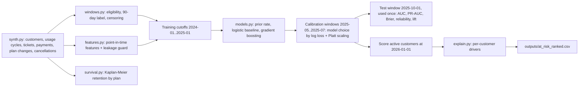

> **Proprietary - All Rights Reserved.** (c) 2026 Sandeep Grover. This repository is licensed to Sandeep Grover and may **not** be used, run, copied, modified, distributed, or used to train models without prior written permission. Public visibility does not grant a license. See [LICENSE](LICENSE).

---

# churn-modeling-demo

A small, runnable churn-modeling sample for a subscription business. It shows the parts that usually decide
whether a churn model can be trusted: a precise churn label, point-in-time features with a leakage guard,
right-censoring, an honest baseline, calibrated probabilities and a ranked at-risk list with per-customer
drivers. Everything runs on **synthetic data generated in code with a fixed seed**. No real customer data
and no API keys are used.

## Quick start

```bash
python3.11 -m venv .venv && source .venv/bin/activate
pip install -r requirements.txt      # numpy 2.4.6, pandas 3.0.6, scikit-learn 1.9.1, pytest 9.1.1
python -m pytest -q                  # 26 tests
python main.py                       # writes outputs/ (about 10 seconds)
```

## Definitions

| Term | Definition used here |
|---|---|
| Cutoff | The "as of" date. Features use only rows whose `event_time` is strictly before it. |
| Eligible | Signed up before the cutoff, with no cancellation known before the cutoff. |
| Prediction window | `[cutoff, cutoff + 90 days)`. Label 1 = cancels inside it, 0 = still active at its end. |
| Right-censored | The window runs past the data extract (2025-12-31) and no cancellation was seen: the outcome is unknown, so the row gets no binary label. It keeps its partial duration for survival summaries. |
| Observation window | Usage, tickets, payments and plan changes in the 90-120 days before the cutoff. |

## Pipeline



The time split is checked in code (`check_temporal_split`): every training label window must end before the
next window starts, so no training row has seen an outcome from the calibration or test period.

## Results with the default seed (`python main.py`)

Test window: cutoff 2025-10-01, 1886 eligible customers, churn rate 8.2%.

| Model | ROC-AUC | PR-AUC | Brier | Brier skill | ECE | Top-decile lift |
|---|---|---|---|---|---|---|
| Prior rate (everyone gets the training churn rate) | 0.500 | 0.082 | 0.0750 | -0.000 | 0.0046 | 0.97 |
| Logistic regression (baseline) | 0.741 | 0.209 | 0.0700 | 0.066 | 0.0083 | 3.11 |
| Gradient boosting, raw | 0.742 | 0.233 | 0.0697 | 0.070 | 0.0099 | 3.18 |
| Gradient boosting + Platt calibration (final) | 0.742 | 0.233 | 0.0698 | 0.069 | 0.0087 | 3.18 |

Brier skill compares against always predicting the base rate. ECE is the expected calibration error over ten
probability bins. On this synthetic data the churn signal is close to additive, so gradient boosting only ties
the logistic baseline; that is the reason to fit a baseline first. Calibration windows chose `gbm_calibrated`.

**Leakage, measured.** The same gradient-boosting model trained on whole-extract aggregates (the shortcut a quick
notebook often takes) scores ROC-AUC 0.802 on the test window, against
0.742 with point-in-time features. The higher number would not hold up in production.
`tests/test_leakage.py` scrambles every row after the cutoff and requires the features to stay identical.

**Censoring, counted.** At cutoff 2025-11-01, 1925 customers are eligible; 120
cancel before the extract and 1805 have no observable 90-day outcome yet. Labelling those
as "retained" would bias the churn rate down.

## Outputs

| File | Content |
|---|---|
| `at_risk_ranked.csv` | Active customers ranked by risk: 90-day churn probability, risk decile, expected revenue at risk, top three drivers |
| `metrics.json` | Test metrics for every model, calibration-window log loss, leakage comparison |
| `reliability.csv` | Predicted vs observed churn per probability bin (reliability diagram data) |
| `decile_lift.csv` | Churners captured per risk decile |
| `feature_importance.csv` | Permutation importance (drop in test ROC-AUC) |
| `km_by_plan.csv` | Kaplan-Meier retention curves by signup plan, censored at the extract date |
| `run_summary.json` | Seed, windows, row counts, censoring counts, package versions |

## Using the ranked list

Drivers come from reference substitution: each feature is set to a typical value and the change in predicted
risk is recorded. They explain the model's ranking; they are not causal effects. A high-risk customer is not
necessarily one a retention offer will save (some leave regardless, some would have stayed anyway). To learn who
responds to an offer, run the campaign with a random holdout group and compare churn between treated and
held-out customers in the same risk band; with enough of those results, an uplift model can target persuadable
customers instead of high-risk ones.

## Layout

```
churnkit/synth.py      synthetic data, fixed seed, extract-time columns that would leak
churnkit/windows.py    eligibility, label window, censoring, temporal split check
churnkit/features.py   point-in-time features, leakage guard, deliberately leaky builder for comparison
churnkit/survival.py   Kaplan-Meier estimator and tenure table
churnkit/models.py     prior-rate, logistic and gradient-boosting models, Platt/isotonic calibration
churnkit/evaluate.py   ROC-AUC, PR-AUC, Brier, ECE, reliability bins, decile lift
churnkit/explain.py    per-customer drivers
churnkit/pipeline.py   end-to-end run
tests/                 26 pytest tests
```
